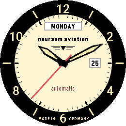
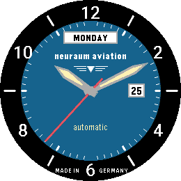
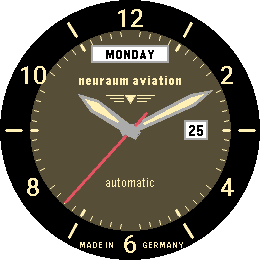

# Neuraum

*A classic pilot's automatic for the Pebble Round 2.*

  

A Pebble watchface (v1.0.0).

Neuraum recreates the look of a classic German pilot's automatic watch on
the round display of the Pebble Round 2: a black flange with cream numerals,
a cream dial with day and date windows, and slim sword hands with luminous
inlays.

The flange carries the even hours as upright numerals and the odd hours as
cream bars that continue as dark indices on the dial. A fine minute track
runs along the edge of the dial. Below the twelve sits a framed day window,
followed by the neuraum aviation lettering and the winged emblem. The date
sits in its own window at three, the word automatic above the six.

The second hand is optional. Without it the face redraws only once a minute.
Neuraum makes no network requests and uses no sensors.

## Settings

- Dial colour - Cream, Anthracite, Blue, Silver or Olive.
- Second hand - on or off.
- Day window - show or hide the day of the week.
- Day names - English (MONDAY) or German (MONTAG).
- Date window - show or hide the date at three.

## Platforms

- Pebble Round 2 (`gabbro`)

## Building

With the [Pebble SDK](https://developer.repebble.com/sdk/):

```bash
pebble build
pebble install --emulator gabbro
```

The repository can also be imported into CloudPebble as is.

## Release notes

### 1.0.0

First release.

## License

MIT License, see [LICENSE](LICENSE). The bundled Roboto font is not covered
by it and remains under the Apache License 2.0.
